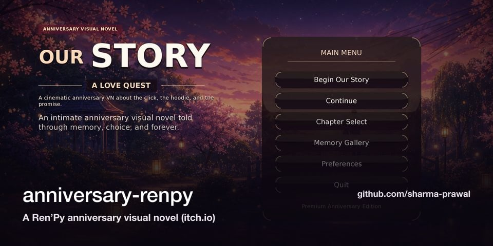

  
  
  
  

## 🚀 About me

Technology Manager with **9+ years** of leading engineering teams and shipping scalable, high-impact systems for global clients across the **US, UK and South Africa**. I specialise in AI-enabled, cloud-native solutions — LLM integrations, intelligent automation, microservices, event-driven and serverless architecture — pairing strong engineering fundamentals with modern AI tooling.

**Claude Certified Architect (Anthropic)** · AWS, Azure and GCP certified · Media (advertising data) and Banking (payments) domains.

### 🏆 [Check Out My Full Portfolio Website](https://prawal-personal-brand.vercel.app)

| 🧭 9+ yrs | ⚡ 160K+ | 🤖 20–30% | 🔌 200+ |
|:---:|:---:|:---:|:---:|
| engineering & team leadership | daily banking transactions at 99.9% uptime | productivity lift from AI-assisted workflows | data sources integrated on one platform |

## 💼 Experience — Successive Digital, Noida *(Aug 2017 – present)*

| Role | Period | Highlights |
|---|---|---|
| **Technology Manager** | Nov 2024 – Present | Lead global client engagements; introduced AI-assisted development (code gen, debugging, docs) for ~20–30% productivity gains; built LLM & intelligent-data POCs; mentor engineers across full-stack and cloud. |
| **Technology Lead** | Jul 2021 – Nov 2024 | End-to-end delivery with 100% client satisfaction and zero escalations; owned architecture across MERN, PHP and GraphQL; led a team of 11 on a 200+ source connectors platform. |
| **Software Engineer** | Oct 2019 – Jul 2021 | Technical lead for 3 parallel pods for a global advertising enterprise (Node.js, React, Redux, GraphQL). |
| **Associate Software Engineer** | Mar 2018 – Sep 2019 | Led a team of 4; scalable APIs and backend optimisation, ~50% lift in customer satisfaction. |
| **Software Engineer Trainee** | Aug 2017 – Feb 2018 | Internal tools — room booking and HR letter automation (PHP, Laravel, Lumen). |

## 🧩 Selected work

- **Data Refinery** *(Media advertising · Technical Lead)* — governed data-activation platform serving 87+ sources with 1–2 day onboarding: connectors, cleansing recipes and delivery to S3, GCP, Snowflake and analytics tools.
- **Enrollment & Transactions** *(Fintech · Team Lead & Engineering Manager)* — white-labelled ACH payment platform: enrollment APIs, transaction ops, fraud scoring, compliance reporting, identity flows.
- **AI-Driven Datasource Intelligence** *(AI/ML POC · 2026)* — predicts pipeline schedule risk before the first run using XGBoost with explainable AI.
- **Taxonomy** *(Media advertising)* — dependency-driven spreadsheet engine generating unique campaign identifiers (React, GraphQL, Apollo, Node.js, MongoDB).

## 🛠️ Things I've built on my own time

<table>
  <tr>
    <td width="50%" valign="top">
      
       <b>Portfolio</b> — career journey, projects, awards and certifications
       <a href="https://prawal-personal-brand.vercel.app">Live</a> · <a href="https://github.com/sharma-prawal/prawal-personal-brand">Code</a> · React · Tailwind · Framer Motion
    </td>
    <td width="50%" valign="top">
      
       <b>Prawal — The Series</b> — my career as a streaming-style series
       <a href="https://prawal-the-series.vercel.app">Live</a> · <a href="https://github.com/sharma-prawal/prawal-the-series">Code</a> · React · TypeScript · Lenis
    </td>
  </tr>
  <tr>
    <td width="50%" valign="top">
      
       <b>Project Taj</b> — third-person 3D exploration of a Taj Mahal garden
       <a href="https://project-tajmahal.vercel.app">Live</a> · <a href="https://github.com/sharma-prawal/project-tajmahal">Code</a> · Three.js · React Three Fiber
    </td>
    <td width="50%" valign="top">
      
       <b>Our Story: A Love Quest</b> — a story-driven 2D adventure game
       <a href="https://praashi.fun">Play</a> · <a href="https://github.com/sharma-prawal/anniversary-game">Code</a> · Phaser 3 · Vite
    </td>
  </tr>
  <tr>
    <td width="50%" valign="top">
      
       <b>Our Story — visual novel</b> — a Ren'Py anniversary visual novel
       <a href="https://prawalsharma.itch.io/praashi">Play on itch.io</a> · <a href="https://github.com/sharma-prawal/anniversary-renpy">Code</a> · Ren'Py · Python
    </td>
    <td width="50%" valign="top">
      
       <b>3D Tic Tac Toe</b> — polished Three.js game with PvP and AI modes
       <a href="https://gemini-tic-tac-toe-3d.vercel.app">Play</a> · <a href="https://github.com/sharma-prawal/gemini-tic-tac-toe-3d">Code</a> · Three.js · GSAP · TypeScript
    </td>
  </tr>
  <tr>
    <td width="50%" valign="top">
      
       <b>Inkleaf</b> — an offline-first Android notes app
       <a href="https://drive.google.com/file/d/13aSm6vWk6QgMb-ql8sTBPFigEvJll7xN/view?usp=drive_link">Download APK</a> · <a href="https://github.com/sharma-prawal/easy-notes-app">Code</a> · Kotlin · Android
    </td>
    <td width="50%" valign="top">
      
       <b>Sun Rise Model Public School</b> — the school's website
       <a href="https://sunriseschoolkandi.org/">Live</a> · <a href="https://github.com/sharma-prawal/updated-sunrise-public-school">Code</a> · React · Vite · Tailwind
    </td>
  </tr>
</table>

More: <a href="https://github.com/sharma-prawal/fbp-bills">fbp-bills</a> (reimbursement PDF studio) · <a href="https://github.com/sharma-prawal/tic-tac-toe-minimax">Quantum Tic-Tac-Toe</a> · <a href="https://github.com/sharma-prawal/prawal-cinematic-portfolio">cinematic portfolio</a> · <a href="https://github.com/sharma-prawal?tab=repositories">all repositories →</a>

## 🧰 Tech stack

  
   
  

**AI & architecture:** LLM integrations · Agentic AI · MCP · Claude API & Agent SDK · prompt engineering · XGBoost · system design · microservices · event-driven · serverless

## 🏅 Certifications

  
  
  
  
  
  
  
  
  

<b>All certifications</b>

- **Anthropic** — [Claude Certified Architect – Foundations](https://www.credly.com/badges/467e2ffa-4f8f-42cc-9e96-fc10ab32ec36) (2026)
- **AWS** — [Certified AI Practitioner](https://www.credly.com/badges/d8c7e77d-605f-4620-b920-8b2018c0e650) (2025); [Certified Developer – Associate](https://www.credly.com/badges/8e2c3313-8bbe-4e13-aca8-22109090bb54) (2022); [Certified Solutions Architect – Associate](https://www.credly.com/badges/bda393db-4d7e-4cf7-8dc4-188c37b1f785) (2021); AWS Partner [Cloud Economics](https://www.credly.com/badges/4c1636b7-2a85-49cb-ba88-5a91a2dc4590), [Business](https://www.credly.com/badges/2f7cf415-0cb6-4cf1-8e29-4a5998518b9f) & [Technical](https://www.credly.com/badges/b100da38-c2e7-45f0-891a-846a580cd553) accreditations
- **Microsoft** — [Azure AI Fundamentals](https://www.credly.com/badges/bb97745d-eea6-447d-8ec3-2d992f2abb51) (2022); [Security, Compliance & Identity Fundamentals](https://www.credly.com/badges/2c204e59-54ce-4375-8973-ef4f3cba1dfd) (2022); [Azure Data Fundamentals](https://www.credly.com/badges/ae5db517-5e17-402b-aa62-9ba9314669e4) (2021); [Azure Fundamentals AZ-900](https://www.credly.com/badges/e0cda659-1a0c-42b2-9f6b-0eca5d3f3df8) (2021)
- **Google Cloud** — [Cloud Digital Leader](https://www.credly.com/badges/56d4e7b7-b32f-43f4-87b6-b2d038479e39)
- **Apollo GraphQL** — Graph Developer – Professional (2022); Graph Developer – Associate (2022)
- **Scrum Alliance** — Certified Agile Leadership Essentials, CAL-E (2023)
- **ICTRD** — Artificial Intelligence and Machine Learning Program (2026)
- **HackerRank** — [11 skill certificates](https://www.hackerrank.com/profile/PrawalSharma) (JavaScript, Node.js, REST API, React, SQL Advanced, Problem Solving)

All verified badges: [credly.com/users/sharma-prawal](https://www.credly.com/users/sharma-prawal) · full list on [LinkedIn](https://www.linkedin.com/in/sharma-prawal/details/certifications/)

## 🎖️ Honours & awards

  

## 📊 GitHub activity

  
  
   
  
    
  <picture>
    <source media="(prefers-color-scheme: dark)" srcset="https://raw.githubusercontent.com/sharma-prawal/sharma-prawal/output/github-snake-dark.svg" />
    
  </picture>

## 🎓 Education & more

- **B.Tech, Computer Science** — Maharshi Dayanand University (2012 – 2016)
- Contributor — *The Subtle Art of Effective Communication*
- Conferences — AI Impact Summit 2026, Convergence India Expo 2026, AWS Public Sector Symposium 2023, MongoDB.local, IAMAI India Digital Summit
- 15 LinkedIn recommendations · English, Hindi, Punjabi

  Open to conversations about AI-enabled engineering, platform architecture and building great teams.

